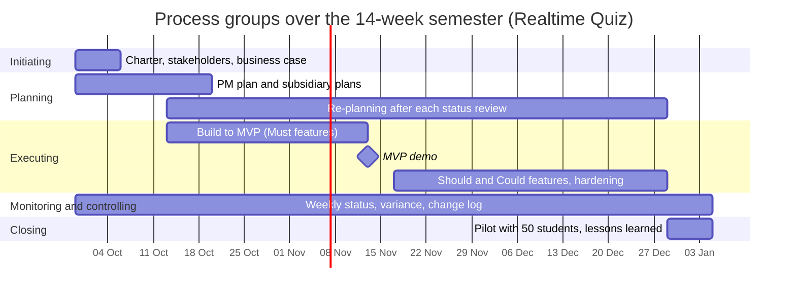

# Process groups over the semester

Week n starts 7 x (n - 1) days after 2026-09-29: week 3 = 2026-10-13, week 7 = 2026-11-10, week 8 = 2026-11-17, week 14 = 2026-12-29.

| Process group | Weeks active | Main activities | Outputs | Lab that produces them |
|---------------|--------------|-----------------|---------|------------------------|
| Initiating | 1 | classify the work, write the charter, identify stakeholders, justify with a business case | charter, stakeholder list, business case | Lab-01 |
| Planning | 1-3 (first burst), then 3-13 re-planning | scope, schedule, cost, risk and subsidiary plans; re-plan after each status review | project management plan and baselines, updated plans | Labs 02-08 |
| Executing | 3-13 (MVP in week 7, hardening to week 13) | build the ten phases, demo each phase, run the load test | working increments, MVP, tested release | the build itself; evidence in later labs |
| Monitoring and controlling | 1-14 | weekly status meeting, schedule and cost variance, risk review, change requests | status reports, change log, updated baselines | Labs 05, 06, 09 (tools), every lab (practice) |
| Closing | 14 | pilot with 50 students, handover to IT operations, lessons learned | pilot report, runbook, lessons learned | final lab |

## Phase gates

At each gate the sponsor decides to continue, change or stop, based on evidence that the business case still holds (continued business justification).

- **Week 1, charter approval:** evidence is the signed charter, the business case with option C recommended, and the first stakeholder list. Without a signed charter the project does not start.
- **Week 7, MVP demo:** evidence is a live demo of all 8 Must features, the effort and cash spent against the 490 h and 200 USD, and the updated risk list. If the demo fails, the review gate in the business case applies (switch to option B for next semester).
- **Week 13, pilot readiness:** evidence is the load test at 100 simulated students passing, data approval received from the data protection officer, and the runbook handed to IT operations. If one item is missing, the pilot is moved or reduced with the sponsor's written approval.
